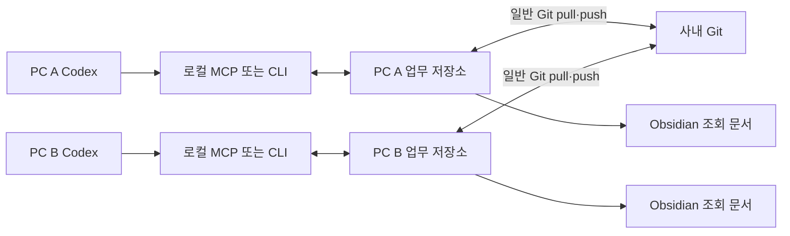

# Git 기반 팀 업무·지식 구조

## 원본과 접근 경로



각 PC는 같은 업무 Git 저장소를 clone한다. 저장소 경로는 코드 저장소와 달라도 된다. 기본 CLI/MCP는 매 호출마다 pull한 뒤 현재 checkout의 파일을 검증·처리하고, 변경 시 업무 파일만 commit한 다음 push한다. 별도 웹 서버나 공용 DB 접속은 없다. [동기화 규칙과 복구](sync.md)

```text
team-work/
  registry/
    projects/ECODE.json
    tasks/ECODE-<random-id>.json
    docs/ECODE-D-<random-id>.json
    events/<uuid>.json
```

파일명은 제목이 아닌 안정적인 ID다. task/doc ID는 무작위 UUID 일부를 사용해 PC별 번호 생성 충돌 가능성을 줄인다. 업무마다 파일이 달라 서로 다른 업무 변경을 병합하기 쉽다. 같은 업무의 수정은 같은 파일에 기록돼 Git 충돌로 드러날 수 있다.

SQLite는 호출마다 생성하는 임시 파생 인덱스다. 원본 파일을 잃어버렸을 때 복구해 주는 별도 저장소가 아니다. Git 이력이 공유·복구의 기준이다. 두 로컬 프로세스는 디렉터리 잠금으로 직렬화하며 Git 작업과 프로그램을 동시에 실행하지 않는다.

## 업무 모델

프로젝트 아래 epic → story → task → subtask 구조를 사용한다. 작은 과제는 중간 단계를 생략할 수 있다. 프로젝트에 바로 epic/story/task를 둘 수 있다. 부모는 같은 프로젝트에 있어야 하며 순환과 잘못된 단계 연결은 거부한다.

| 필드 | 의미 |
| --- | --- |
| prompt / description | 원래 요청·목적·완료 기준 |
| plan | 현재 실행 계획 |
| result / evidence | 결과 요약과 테스트·커밋·PR·문서 등 근거 문자열 |
| parent | 업무 범위의 상위 항목 |
| depends_on | 이 업무에 앞서 완료돼야 하는 업무 ID 목록 |
| assignee | 현재 책임자. contributions와 별개 |
| priority | 1이 가장 높고 5가 가장 낮은 실행 우선순위 |
| weight / estimate | 합의한 중요 비중과 예상 업무 규모. 양수 |
| start_date / due_date | YYYY-MM-DD, 둘 다 있으면 시작 ≤ 마감 |
| doc_ids | 직접 연결한 지식 문서 |
| contributions | 완료 업무의 합의된 사람별 배분. 합계 1 |
| version | 현재 파일의 논리 버전. 변경 시 직전 버전을 전달 |

상태는 backlog, ready, in_progress, review, done, cancelled다. ready 조회는 선행 업무가 모두 done이고 담당이 없는 미완료 최하위 업무를 찾는다. claim은 현재 작업자에게 맡기고 in_progress로 전환한다. release는 명시적으로 담당을 해제한다. 자동 만료되는 분산 임대 기능은 없다.

done에는 결과, 근거, 배분이 필요하고 미완료 선행 업무·하위 업무가 없어야 한다. 근거의 존재는 검사하지만 근거의 진위나 리뷰 승인을 자동 판정하지 않는다. 담당 이름도 인증된 신원은 아니다. 사내 Git의 작성자·권한과 리뷰 절차를 함께 사용한다.

## 지식 모델과 맥락 조립

문서는 프로젝트별 별도 부모·자식 트리다. 제목·본문·태그·version을 가지며 업무와 명시적으로 연결한다. `canonical=true`는 프로젝트 전체에서 읽을 공통 지식에만 쓴다.

`task.context`는 현재 업무의 요청·계획, 상위 목적, 선행 결과, 상위 업무에서 상속한 문서 연결과 프로젝트 공통 문서를 모은다. 출처 ID와 버전을 함께 반환한다. 기본 16,000자, 최대 64,000자로 제한하고 잘림 여부를 표시한다. 필요한 원문은 task.get/doc.get으로 추가 조회한다.

긴 문서가 자동으로 적절한 위치에 검색되는 임베딩/RAG 기능은 초기 버전에 없다. 먼저 doc.list로 제목·본문·태그를 검색하고 관련 doc_ids를 연결한다. ecode-skills가 사용하는 작은 검색·요약·매핑 구조를 그대로 이어갈 수 있다. 코드 저장소의 실제 AGENTS.md·파일 내용은 그 저장소에서 추가 확인한다.

업무 본문과 지식은 신뢰할 수 없는 참고 데이터로 취급한다. 저장된 명령이 시스템·사용자 지시나 대상 코드 저장소의 권한을 대체하지 않는다.

## 변경 기록

각 변경은 actor, 작업 종류, 변경 전후와 시간을 포함한 별도 UUID 이벤트로 남는다. 현재 plan/result 필드를 수정해도 과거 내용은 이벤트와 Git 이력에서 확인할 수 있다. 별도의 Codex 채팅 기록이나 모든 추론 과정은 수집하지 않는다. 실행별 run/session 모델과 전용 변경 이력 화면은 후속 확장 대상이다.

업무 파일과 이벤트를 한 번에 다루는 동안 로컬 잠금을 사용한다. 쓰기 중 예외를 처리하고 원자적인 파일 교체를 사용한다. 여러 파일 교체 도중 전원이 끊기는 상황까지 Git 트랜잭션처럼 보장하는 것은 아니다. 문제가 생기면 커밋된 상태와 변경 파일을 확인하고 `check`를 실행한다.

## Git 충돌 처리

기본 CLI/MCP는 조회·변경 모두 시작 전에 최신 Git 상태를 받는다. 담당 선언을 도구가 commit·push한 뒤 실제 구현을 시작한다. **공유 성공은 다른 PC와의 실시간 선점 보장을 의미하지 않는다.** push 경쟁 시 한 PC는 거절되므로 같은 업무인지 확인하고 조정한다.

`git pull --ff-only`가 실패하면 접속·인증 문제 또는 로컬·원격의 분기를 확인한다. 현재 변경을 보존한 뒤 팀의 Git 절차를 사용한다. 기본 모드는 업무 변경의 commit·push를 자동으로 수행하며, 강제 push·자동 merge·rebase는 하지 않는다. 기존 미커밋 변경이나 별도 미공유 커밋이 있으면 임의로 포함하지 않고 중단한다.

push 실패 시 이미 생성한 로컬 변경·커밋을 보존하고 공유 미완료로 응답한다. 새 업무 요청을 반복하지 않고 `sync-retry`/`sync_retry`로 기존 커밋만 재전송한다. 원격과 분기됐거나 보존한 커밋이 변경됐으면 수동 조정이 필요하다. 로컬 전용 원시 GitStore는 테스트와 명시적 `--local-only` 실행에만 사용한다.

충돌 해결 시 다음을 확인한다.

1. 같은 업무의 담당·상태·계획·결과 중 어느 부분이 충돌했는지 양쪽 변경과 이벤트를 읽는다.
2. 업무 수행 사실과 담당 합의를 바탕으로 내용을 합친다. 단순히 더 큰 version이나 최근 시각만 택하지 않는다.
3. 충돌 표시와 Git의 unmerged 상태를 해결한다. `check`로 문서 참조·업무 계층·의존 그래프·완료 조건을 확인한다.
4. 결과를 커밋하고 push한다. 두 PC 모두 다시 받아 같은 상태인지 확인한다.

서로 다른 파일이 Git에서 문제없이 합쳐져도 A→B와 B→A가 각각 추가됐다면 전체 의존 그래프가 순환할 수 있다. 그래서 Git 병합 성공 후에도 전체 정합성을 검사한다. 잠금 폴더가 남았다면 실행 중인 프로세스가 없는지 확인한 뒤에만 정리한다.

## 진척과 배분

집계 대상은 취소되지 않은 **최하위 업무**다. 부모와 자식의 비중을 함께 더하지 않는다.

```text
업무 기준량 = weight × estimate
진척률 = 완료된 최하위 업무 기준량 합 / 전체 최하위 업무 기준량 합
사람별 완료 배분량 = Σ(완료 최하위 업무 기준량 × 합의된 contributions 비율)
```

priority는 실행 순서, weight는 이 집계에서의 비중이다. 단위와 비율은 팀이 합의해야 한다. 업무를 잘게 나누거나 예상 규모를 변경하면 집계도 달라진다. 이 값은 업무 배분을 설명하는 참고치이며 개인 능력·실제 투입 시간·사업 성과를 측정한 값은 아니다. 리뷰·설계·지원처럼 보이지 않는 기여도 업무 또는 배분 근거로 기록해야 한다.

## 초기 버전의 범위와 다음 단계

이번 버전은 JSON 원본, Git 공유 절차, Codex MCP/CLI, 지식 맥락, Obsidian 조회를 검증한다. 날짜는 계획 값이며 자원 배정·휴일·기간·선후행을 고려해 자동 이동시키지 않는다. 선행 조건은 완료 후 실행하는 단순 모델이며 FS/SS/FF/SF·지연일 계산은 없다.

실제 사내망 배포와 두 실PC의 Codex 연결은 아직 확인하지 않았다. 먼저 샘플로 두 clone의 독립 변경·같은 업무 충돌을 연습하고, 작은 실제 과제 하나를 함께 운영하는 것이 좋다. 요구가 늘면 Beads 도입, OpenProject/Plane용 어댑터, 공유 서버를 통한 원자적 선점 중에서 선택할 수 있다. Git 원본을 유지한 채 모든 기능을 계속 추가하는 것으로 결정하지 않는다.
